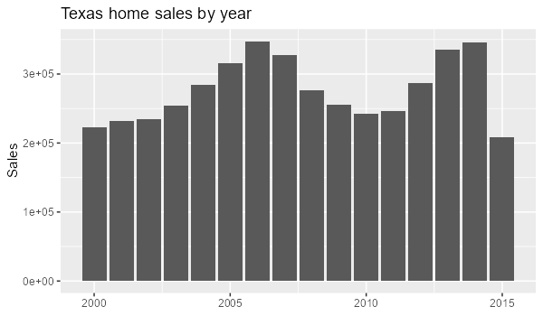

```{r}
#| context: setup
library(shiny)
library(tidyverse)
library(plotly)
library(DT)
titanic <- read_csv("https://bryantstats.github.io/math421/data/titanic_final.csv")
tx <- txhousing |>
  drop_na(sales, median, listings) |>
  mutate(date = make_date(year, month))
empty_plot <- function(msg = "No rows match these inputs.") {
  plotly_empty() |> layout(title = list(text = msg, y = 0.5))
}
```

# Q3

## {.sidebar}

**Titanic - selectInput**

```{r}
selectInput("q3_var", "Choose a variable", choices = c("Sex", "Pclass", "Embarked"))
```

## Column {.tabset}

```{r}
#| title: Survival by the chosen variable
plotlyOutput("q3_p1")
```

```{r}
#| title: Data
DTOutput("q3_tbl")
```

# Q4

## {.sidebar}

**Cars - selectInput**

```{r}
selectInput("q4_var", "Group by", choices = c("class", "drv", "fl"))
```

## Column {.tabset}

```{r}
#| title: Highway mpg
plotlyOutput("q4_p1")
```

```{r}
#| title: Count
plotlyOutput("q4_p2")
```

```{r}
#| title: Data
DTOutput("q4_tbl")
```

# Q5

## {.sidebar}

**Cars - checkboxGroupInput**

```{r}
checkboxGroupInput("q5_drv", "Drive", choices = c("4", "f", "r"), selected = c("4", "f", "r"))
```

## Column {.tabset}

```{r}
#| title: Engine size and highway mpg
plotlyOutput("q5_p1")
```

```{r}
#| title: Cars by class
plotlyOutput("q5_p2")
```

```{r}
#| title: Data
DTOutput("q5_tbl")
```

# Q6

## {.sidebar}

**Cars - sliderInput**

```{r}
sliderInput("q6_displ", "Engine size", min = 1.6, max = 7, value = c(1.6, 7), step = 0.1)
```

## Column {.tabset}

```{r}
#| title: Engine size and highway mpg
plotlyOutput("q6_p1")
```

```{r}
#| title: City mpg
plotlyOutput("q6_p2")
```

```{r}
#| title: Data
DTOutput("q6_tbl")
```

# Q7

## {.sidebar}

**Cars - radioButtons**

```{r}
radioButtons("q7_year", "Model year", choices = c(1999, 2008))
```

## Column {.tabset}

```{r}
#| title: Highway mpg by class
plotlyOutput("q7_p1")
```

```{r}
#| title: Engine size
plotlyOutput("q7_p2")
```

```{r}
#| title: Data
DTOutput("q7_tbl")
```

# Q8

## {.sidebar}

**US Economy - dateRangeInput**

```{r}
dateRangeInput("q8_dates", "Dates", start = min(economics$date), end = max(economics$date),
               min = min(economics$date), max = max(economics$date))
```

## Column {.tabset}

```{r}
#| title: Unemployed (thousands)
plotlyOutput("q8_p1")
```

```{r}
#| title: Personal savings rate
plotlyOutput("q8_p2")
```

```{r}
#| title: Data
DTOutput("q8_tbl")
```

# Q9

## {.sidebar}

**Cars - Combined Inputs**

```{r}
selectInput("q9_var", "Color by", choices = c("class", "drv", "fl"))
checkboxGroupInput("q9_drv", "Drive", choices = c("4", "f", "r"), selected = c("4", "f", "r"))
sliderInput("q9_displ", "Engine size", min = 1.6, max = 7, value = c(1.6, 7), step = 0.1)
```

## Column {.tabset}

```{r}
#| title: Engine size and highway mpg
plotlyOutput("q9_p1")
```

```{r}
#| title: Count
plotlyOutput("q9_p2")
```

```{r}
#| title: Data
DTOutput("q9_tbl")
```

# Q10

## {.sidebar}

**Texas Housing Market**

```{r}
selectInput("q10_city", "City", choices = sort(unique(tx$city)), selected = "Houston")
radioButtons("q10_measure", "Measure", choices = c("sales", "volume", "listings"))
checkboxGroupInput("q10_months", "Months", choices = 1:12, selected = 1:12, inline = TRUE)
sliderInput("q10_price", "Median price", min = 0, max = 310000, value = c(0, 310000), step = 10000)
dateRangeInput("q10_dates", "Dates", start = min(tx$date), end = max(tx$date))
```

## Column

### Row {height=25%}

```{r}
#| content: valuebox
#| title: "Texas cities"
list(icon = "house", color = "primary", value = n_distinct(tx$city))
```

```{r}
#| content: valuebox
#| title: "Total sales"
list(icon = "cash", color = "success", value = format(sum(tx$sales), big.mark = ","))
```

### Row {height=75% .tabset}

```{r}
#| title: Over time
plotlyOutput("q10_p1")
```

```{r}
#| title: By month
plotlyOutput("q10_p2")
```

```{r}
#| title: Distribution
plotlyOutput("q10_p3")
```

```{r}
#| title: Sales and listings
plotlyOutput("q10_p4")
```

```{r}
#| title: By year
plotlyOutput("q10_p5")
```

```{r}
#| title: Data
DTOutput("q10_tbl")
```

::: {.card title="Findings"}

{width=500}

Texas home sales from 2000 to 2015 rose to a 2007 high of about 328,000, fell to about
246,000 in 2011, and recovered to about 346,000 in 2014. Sales peak in June, and Houston
and Dallas have the most sales. Sales and active listings are strongly correlated (r = 0.92),
mostly because larger cities have more of both.

:::

```{r}
#| context: server

# Q3
output$q3_p1 <- renderPlotly({
  ggplotly(ggplot(titanic, aes(x = .data[[input$q3_var]], fill = Survived)) + geom_bar(position = "fill"))
})
output$q3_tbl <- renderDT(datatable(titanic))

# Q4
output$q4_p1 <- renderPlotly(ggplotly(ggplot(mpg, aes(x = .data[[input$q4_var]], y = hwy)) + geom_boxplot()))
output$q4_p2 <- renderPlotly(ggplotly(ggplot(mpg, aes(x = .data[[input$q4_var]])) + geom_bar()))
output$q4_tbl <- renderDT(datatable(mpg))

# Q5
q5 <- reactive(mpg |> filter(drv %in% input$q5_drv))
output$q5_p1 <- renderPlotly({
  if (nrow(q5()) == 0) return(empty_plot("No cars match these inputs."))
  ggplotly(ggplot(q5(), aes(displ, hwy, color = drv)) + geom_point())
})
output$q5_p2 <- renderPlotly({
  if (nrow(q5()) == 0) return(empty_plot("No cars match these inputs."))
  ggplotly(ggplot(q5(), aes(y = class, fill = drv)) + geom_bar())
})
output$q5_tbl <- renderDT(datatable(q5()))

# Q6
q6 <- reactive(mpg |> filter(displ >= input$q6_displ[1], displ <= input$q6_displ[2]))
output$q6_p1 <- renderPlotly({
  if (nrow(q6()) == 0) return(empty_plot("No cars match these inputs."))
  ggplotly(ggplot(q6(), aes(displ, hwy)) + geom_point())
})
output$q6_p2 <- renderPlotly({
  if (nrow(q6()) == 0) return(empty_plot("No cars match these inputs."))
  ggplotly(ggplot(q6(), aes(cty)) + geom_histogram(bins = 15))
})
output$q6_tbl <- renderDT(datatable(q6()))

# Q7
q7 <- reactive(mpg |> filter(year == input$q7_year))
output$q7_p1 <- renderPlotly(ggplotly(ggplot(q7(), aes(class, hwy)) + geom_boxplot()))
output$q7_p2 <- renderPlotly(ggplotly(ggplot(q7(), aes(displ)) + geom_histogram(bins = 15)))
output$q7_tbl <- renderDT(datatable(q7()))

# Q8
q8 <- reactive(economics |> filter(date >= input$q8_dates[1], date <= input$q8_dates[2]))
output$q8_p1 <- renderPlotly({
  if (nrow(q8()) == 0) return(empty_plot("No months match these inputs."))
  ggplotly(ggplot(q8(), aes(date, unemploy)) + geom_line())
})
output$q8_p2 <- renderPlotly({
  if (nrow(q8()) == 0) return(empty_plot("No months match these inputs."))
  ggplotly(ggplot(q8(), aes(date, psavert)) + geom_line())
})
output$q8_tbl <- renderDT(datatable(q8()))

# Q9
q9 <- reactive({
  mpg |> filter(drv %in% input$q9_drv, displ >= input$q9_displ[1], displ <= input$q9_displ[2])
})
output$q9_p1 <- renderPlotly({
  if (nrow(q9()) == 0) return(empty_plot("No cars match these inputs."))
  ggplotly(ggplot(q9(), aes(displ, hwy, color = .data[[input$q9_var]])) + geom_point())
})
output$q9_p2 <- renderPlotly({
  if (nrow(q9()) == 0) return(empty_plot("No cars match these inputs."))
  ggplotly(ggplot(q9(), aes(.data[[input$q9_var]])) + geom_bar())
})
output$q9_tbl <- renderDT(datatable(q9()))

# Q10
q10 <- reactive({
  tx |>
    filter(city == input$q10_city, month %in% input$q10_months,
           median >= input$q10_price[1], median <= input$q10_price[2],
           date >= input$q10_dates[1], date <= input$q10_dates[2])
})
output$q10_p1 <- renderPlotly({
  if (nrow(q10()) == 0) return(empty_plot())
  ggplotly(ggplot(q10(), aes(date, .data[[input$q10_measure]])) + geom_line())
})
output$q10_p2 <- renderPlotly({
  if (nrow(q10()) == 0) return(empty_plot())
  ggplotly(ggplot(q10(), aes(factor(month), .data[[input$q10_measure]])) + geom_boxplot() + labs(x = "Month"))
})
output$q10_p3 <- renderPlotly({
  if (nrow(q10()) == 0) return(empty_plot())
  ggplotly(ggplot(q10(), aes(.data[[input$q10_measure]])) + geom_histogram(bins = 20))
})
output$q10_p4 <- renderPlotly({
  if (nrow(q10()) == 0) return(empty_plot())
  ggplotly(ggplot(q10(), aes(listings, sales)) + geom_point())
})
output$q10_p5 <- renderPlotly({
  if (nrow(q10()) == 0) return(empty_plot())
  ggplotly(ggplot(q10(), aes(year, .data[[input$q10_measure]])) + stat_summary(fun = sum, geom = "col"))
})
output$q10_tbl <- renderDT(datatable(q10()))
```
