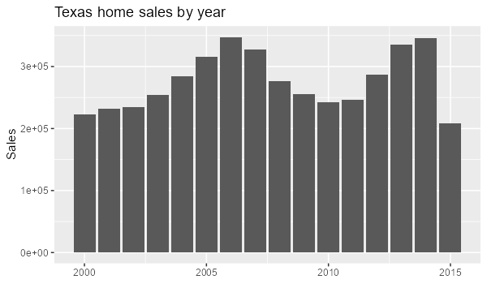

```{r}
#| context: setup
library(shiny)
library(tidyverse)
library(plotly)
library(DT)
df <- txhousing |>
  drop_na(sales, median, listings) |>
  mutate(date = make_date(year, month))
empty_plot <- function() {
  plotly_empty() |> layout(title = list(text = "No rows match these inputs.", y = 0.5))
}
```

# Plots

## {.sidebar}

```{r}
selectInput("city", "City", choices = sort(unique(df$city)), selected = "Houston")
radioButtons("measure", "Measure", choices = c("sales", "volume", "listings"))
checkboxGroupInput("months", "Months", choices = 1:12, selected = 1:12, inline = TRUE)
sliderInput("price", "Median price", min = 0, max = 310000, value = c(0, 310000), step = 10000)
dateRangeInput("dates", "Dates", start = min(df$date), end = max(df$date))
```

## Column

### Row {height=25%}

```{r}
#| content: valuebox
#| title: "Texas cities"
list(icon = "house", color = "primary", value = n_distinct(df$city))
```

```{r}
#| content: valuebox
#| title: "Total sales"
list(icon = "cash", color = "success", value = format(sum(df$sales), big.mark = ","))
```

### Row {height=75% .tabset}

```{r}
#| title: Over time
plotlyOutput("p1")
```

```{r}
#| title: By month
plotlyOutput("p2")
```

```{r}
#| title: Distribution
plotlyOutput("p3")
```

```{r}
#| title: Sales and listings
plotlyOutput("p4")
```

```{r}
#| title: By year
plotlyOutput("p5")
```

# Data

```{r}
#| title: Filtered data
DTOutput("tbl")
```

# Findings

::: {.card title="What the data show"}

{width=500}

Texas home sales from 2000 to 2015 rose to a 2007 high of about 328,000, fell to about
246,000 in 2011, and recovered to about 346,000 in 2014. Sales peak in June, and Houston
and Dallas have the most sales. Sales and active listings are strongly correlated (r = 0.92),
mostly because larger cities have more of both.

:::

```{r}
#| context: server
filtered <- reactive({
  df |>
    filter(city == input$city, month %in% input$months,
           median >= input$price[1], median <= input$price[2],
           date >= input$dates[1], date <= input$dates[2])
})
output$p1 <- renderPlotly({
  if (nrow(filtered()) == 0) return(empty_plot())
  ggplotly(ggplot(filtered(), aes(date, .data[[input$measure]])) + geom_line())
})
output$p2 <- renderPlotly({
  if (nrow(filtered()) == 0) return(empty_plot())
  ggplotly(ggplot(filtered(), aes(factor(month), .data[[input$measure]])) + geom_boxplot() + labs(x = "Month"))
})
output$p3 <- renderPlotly({
  if (nrow(filtered()) == 0) return(empty_plot())
  ggplotly(ggplot(filtered(), aes(.data[[input$measure]])) + geom_histogram(bins = 20))
})
output$p4 <- renderPlotly({
  if (nrow(filtered()) == 0) return(empty_plot())
  ggplotly(ggplot(filtered(), aes(listings, sales)) + geom_point())
})
output$p5 <- renderPlotly({
  if (nrow(filtered()) == 0) return(empty_plot())
  ggplotly(ggplot(filtered(), aes(year, .data[[input$measure]])) + stat_summary(fun = sum, geom = "col"))
})
output$tbl <- renderDT(datatable(filtered()))
```
